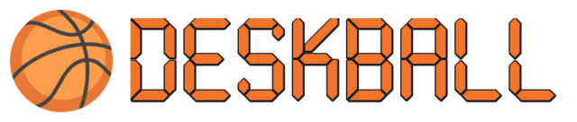
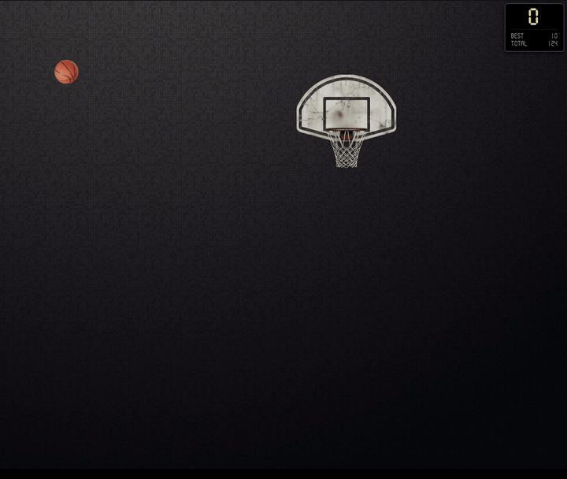

  

  A tiny basketball court right on your desktop. 
  <a href="https://invaderus.github.io/deskball/"><b>Website</b></a> ·
  <a href="https://github.com/Invaderus/deskball/releases/latest"><b>Download</b></a> ·
  <a href="https://invaderus.itch.io/deskball"><b>itch.io</b></a> ·
  <a href="https://invaderus.github.io/deskball/ru/">На русском</a>

  

Deskball opens as a transparent layer over your desktop: grab the ball, flick it towards the hoop, score. When you need your desktop back, minimize it to the tray — the ball will wait for you. Videos keep playing under the game, so you can watch a movie and shoot a few hoops at the same time.

Free, for Windows and Linux. No ads, no internet connection, no data collection.

## Features

- A throw that follows your hand: the ball bounces off the rim, the walls and the floor, and the net catches it when you score
- 6 hoops and 6 balls, each ball with its own weight and bounce — from a light tennis ball to a bowling ball, plus a pumpkin that burns in flight
- 17 achievements that count only real throws
- A burst of sparks for long shots, and your longest basket on the scoreboard
- Drag the hoop and the scoreboard anywhere on the screen
- Practically no CPU use while the ball is resting
- 7 languages: English, Русский, 中文, Deutsch, Français, Español, Português (BR)

## Download

Get the latest build from [Releases](https://github.com/Invaderus/deskball/releases/latest) or from [itch.io](https://invaderus.itch.io/deskball).

- **Windows** — portable `.exe`, no installation needed. Windows SmartScreen may show a warning because the app isn't code-signed: click "More info" → "Run anyway".
- **Linux** — AppImage. Make it executable and run it: `chmod +x Deskball-*.AppImage`

## Controls

- Drag the ball and release it to throw
- Drag the hoop to move it, right-click it for the menu
- `S` — menu and settings · `R` — reset the score · `M` — minimize to the tray · `Esc` — quit

## About this repository

This repository holds the game's website and the release builds. The source code of the game is not published here.

Feedback and bug reports: deskball.flying286@slmail.me

Deskball is made by one person, Invader. Graphics, texts and code were made with the help of AI tools. The font is MOSCOW2024 by Stephan Ahlf, [SIL Open Font License 1.1](fonts/OFL.txt).
